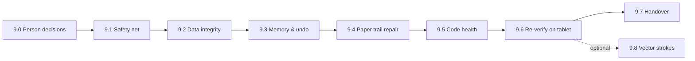

# PLAN — Phase 9: Hardening & Handover (post-audit)

Source: [`AUDIT-2026-11-03.md`](AUDIT-2026-11-03.md). Driven by [`prompts/ORCHESTRATOR.md`](../prompts/ORCHESTRATOR.md) (v2).
Rule: one work package (WP) per subagent task, in order. A WP is **Done** only when its exit check
is met and logged in `state/STATE.md`.

Legend: 🔴 Critical · 🟠 Major · 🟡 Minor · 👤 needs the person

## Order of work

---

## 9.0 — Person decisions 👤 (orchestrator, blocking)

Ask once, record answers in STATE.md → Decisions.

| Q | Options | Default if no answer |
|---|---|---|
| Q1. `apps/simplenotes-android` (Rust port) | a) move out of `simple_notes/` · b) keep, separate track, outside this orchestrator · c) delete `target/` only | b + c |
| Q2. Drawing model | a) stay raster (cheaper, current) · b) add vector stroke model (WP 9.8, High cost) | a |
| Q3. `allowBackup` | a) `false` (strictly offline) · b) keep `true` | a |
| Q4. App name & icon | name string + icon idea | "TouchNotes Clone", simple pen glyph |

## 9.1 — Safety net 🔴 C2 (builder)

- `git init` at `touchnotes-clone/`; `.gitignore` for `build/`, `.gradle/`, `local.properties`, `*.apk`, `*.mp4`.
- First commit = current tree, tag `audit-baseline-2026-11-03`.
- From now on every WP ends with one commit `WP 9.x: 
`.
- **Exit:** `git log --oneline` shows the baseline tag.

## 9.2 — Data integrity 🔴 C1 · 🟠 C3 · 🟡 C9 (builder)

- `exportSchema = true`, `room.schemaLocation = app/schemas`, commit `3.json`.
- Remove `fallbackToDestructiveMigration()`; add an explicit `MIGRATION_x_y` policy (none needed for 3 today — the point is the next bump cannot destroy data).
- Add `MigrationTestHelper` test (needs `androidTest`) or, if instrumented tests are not possible, a JVM test asserting the builder has no destructive fallback.
- Rebuild `flashCardRepository` inside `reloadDatabase()` (make it `@Volatile` like the others).
- Replace the 7 `!!` with null-safe early returns.
- Add a backup → restore → open flashcards round-trip test.
- **Exit:** tests green; `grep fallbackToDestructive` empty; `app/schemas/.../3.json` exists.

## 9.3 — Memory & undo 🟠 C4 (builder)

- Replace "20 full snapshots" with a **byte budget** (e.g. 96 MiB across undo+redo) or dirty-rect tile diffs.
- Add a test that fills a 2048×2048 page with 30 strokes and asserts the undo store stays under budget.
- **Exit (on tablet):** `dumpsys meminfo personal.notes.touch` after 50 strokes on a 2048² page → Total PSS < 512 MB; log saved to `logs/9.3-meminfo.txt`.

## 9.4 — Paper trail repair 🟠 D1–D4 · 🟡 D5–D9 (orchestrator + architect)

- **Oracle cleanup:** `reference/screens/` keeps only original-app captures. Move `clone_*` → `screenshots/clone/`; web/Reddit images & MP4s → `reference/web/` (labelled "third-party, low trust"). Write `reference/screens/INDEX.md` (file → screen → source).
- **Scope reconciliation (architect):** SCOPE.md gets a "Promoted" column — S1, S3, S4 marked *Built (promoted 2026-11-02, retro-recorded 2026-11-03)*. FEATURES.md gets S1/S3/S4 entries with honest status (S4 = raster lasso, not stroke selection).
- **Evidence rule:** record decision "ev_ ids unavailable; sources = analysis files + screenshot paths" so Rule #1 is explicit, not silently relaxed.
- **STATE.md:** rename phase 8 → "8a — Gap remediation (out-of-plan)"; split Decisions into one numbered line each.
- **Mechanical permissions:** copy `agents/*.md` → `.opencode/agents/`.
- **Root tidy:** move `clone_screens/`, `record_*.sh`, `.agents/teamwork/` into `logs/archive/`.
- **Exit:** `reference/screens/` contains no `clone_*`; SCOPE/FEATURES list S1/S3/S4; STATE Decisions one per line.

## 9.5 — Code health 🟠 C6 · C7 · 🟡 C8 · C11 (builder, one file per task)

Split, **behaviour-preserving**, one task each, build + tests after each:
1. `CanvasScreen.kt` → `CanvasScreen` + `ToolDock` + `ToolsPanel` + `ThumbnailDrawer` + `LassoOverlay`.
2. `NoteListScreen.kt` → `ShelfScreen` + `NavRail` + `FabMenu` + dialogs.
3. `SettingsScreen.kt` → per-section composables.
4. `DrawingCanvasView.kt` → extract `UndoStore`, `LassoController`, `PaperRenderer`.

Then: move UI strings to `strings.xml`; add launcher icon + label (Q4); run `./gradlew lintDebug` once online and fix errors.
- **Exit:** no Kotlin file > 800 lines; lint 0 errors; tests green.

## 9.6 — Re-verify on tablet (verifier)

- Install the 9.5 APK on `230b89f8`; redo the 10-screen comparison against `screenshots/tablet/` only.
- Save captures as `screenshots/clone/v2_<nn>_<screen>.png`; logcat per session to `logs/9.6-*.log`.
- Regression checks: create → draw → undo×20 → restore backup → flashcards open (C3) → app upgrade-install keeps notes (C1).
- **Exit:** VERIFY.md v2 section with verdict per screen + the regression table, every claim pointing at a file in `logs/` or `screenshots/`.

## 9.7 — Handover (orchestrator) — the real phase 8

- `README-HANDOVER.md`: APK path, install, build, feature list done/not done, known gaps, how to extend.
- Copy STATE.md → `logs/final-state.md`; tag `v0.2.0`.
- **Exit:** both files exist; person receives the summary.

## 9.8 — Vector stroke model (optional, only if Q2 = b) 🟠 C5

Architect writes the spec first (Stroke entity / file format, migration from existing PNG pages,
hit-testing, renderer), person signs off, then builder in ≥4 tasks. Not started without sign-off.

---

## Tracking

| WP | Owner | Status | Commit / evidence |
|---|---|---|---|
| 9.0 | orchestrator 👤 | Pending | — |
| 9.1 | builder | Pending | — |
| 9.2 | builder | Pending | — |
| 9.3 | builder | Pending | — |
| 9.4 | orchestrator + architect | Pending | — |
| 9.5 | builder | Pending | — |
| 9.6 | verifier | Pending | — |
| 9.7 | orchestrator | Pending | — |
| 9.8 | architect → builder | Not planned unless Q2=b | — |
